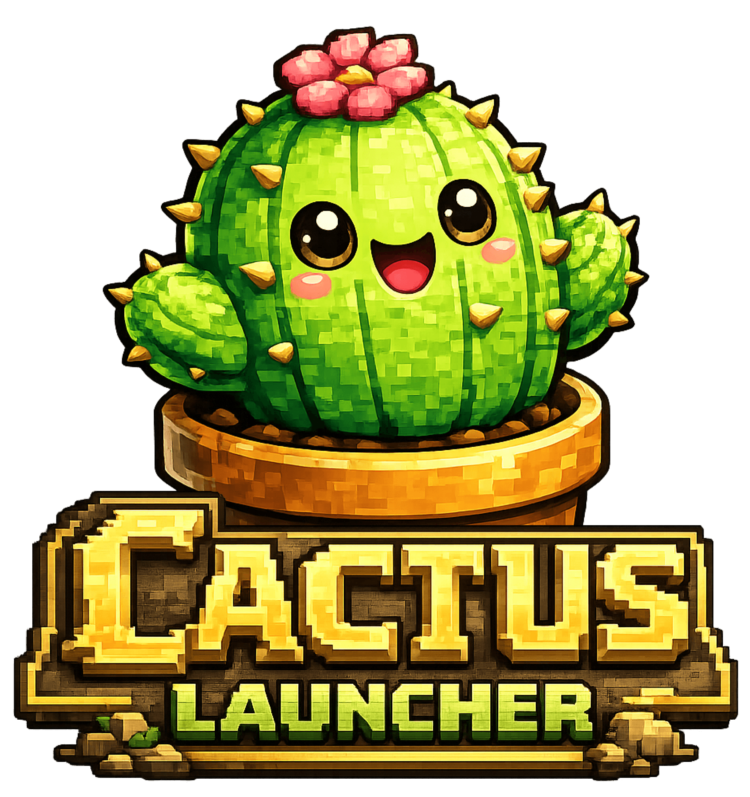
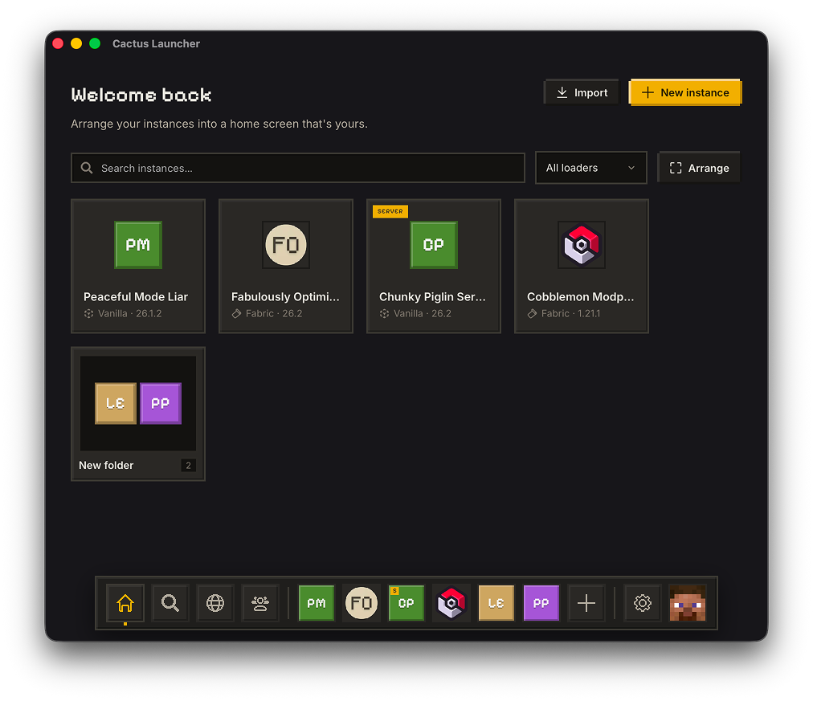
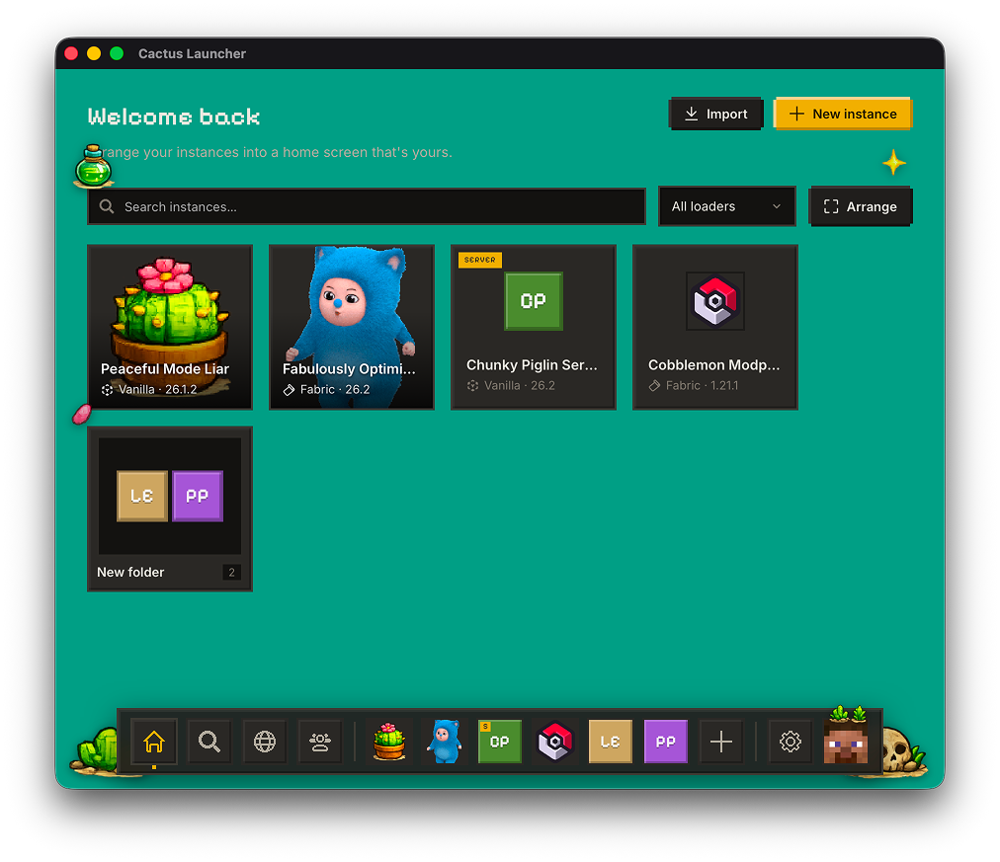
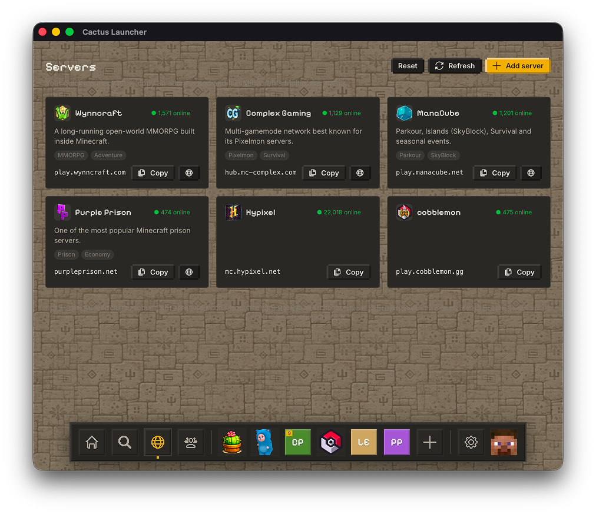
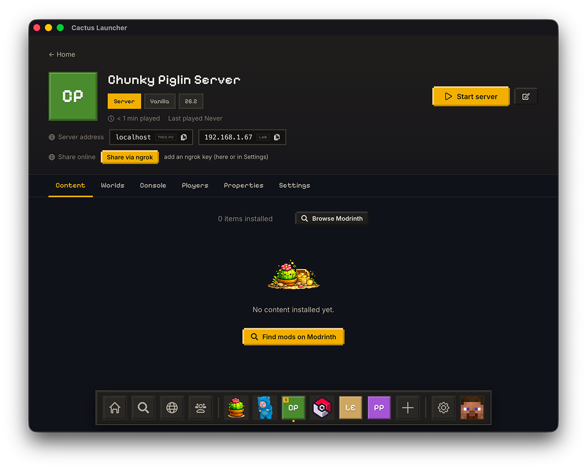
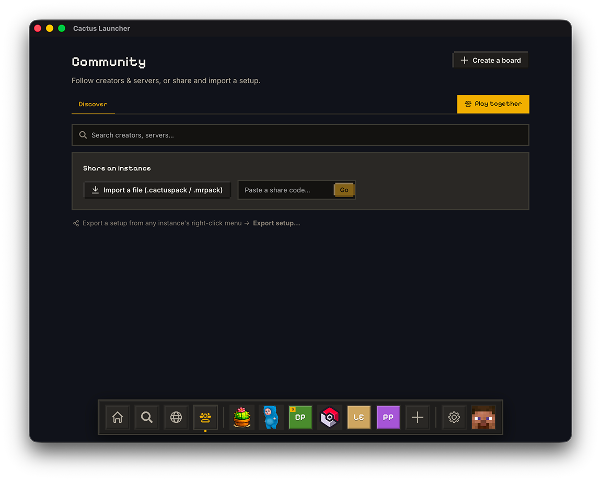
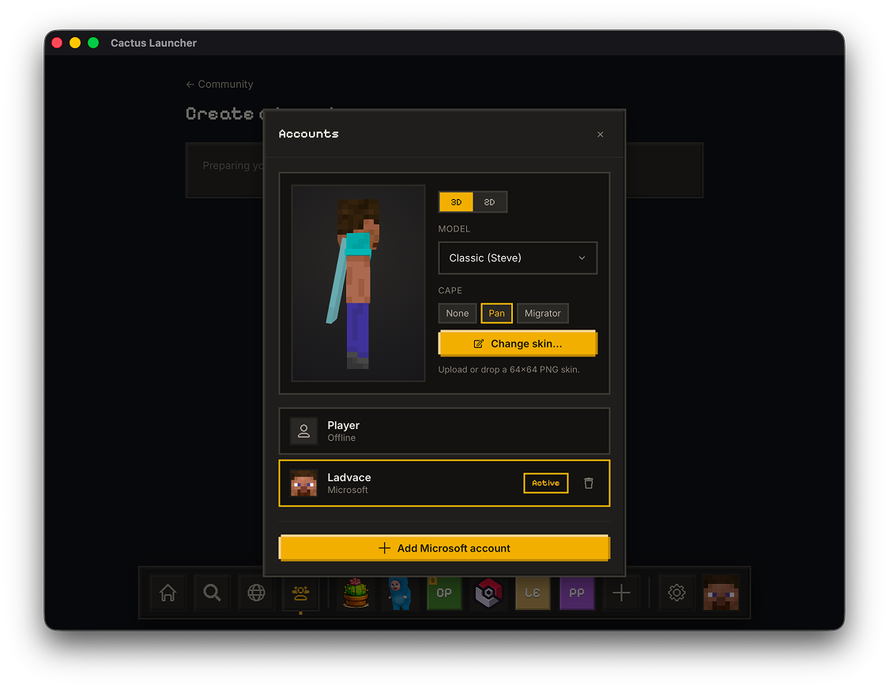
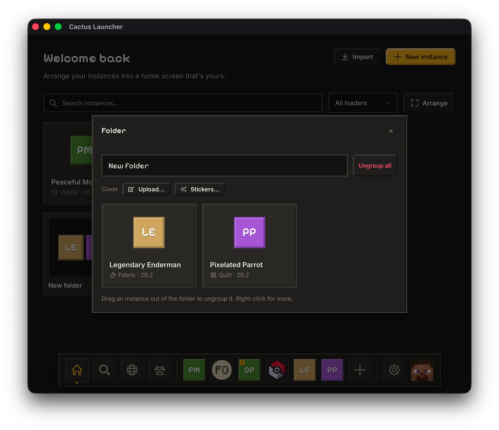
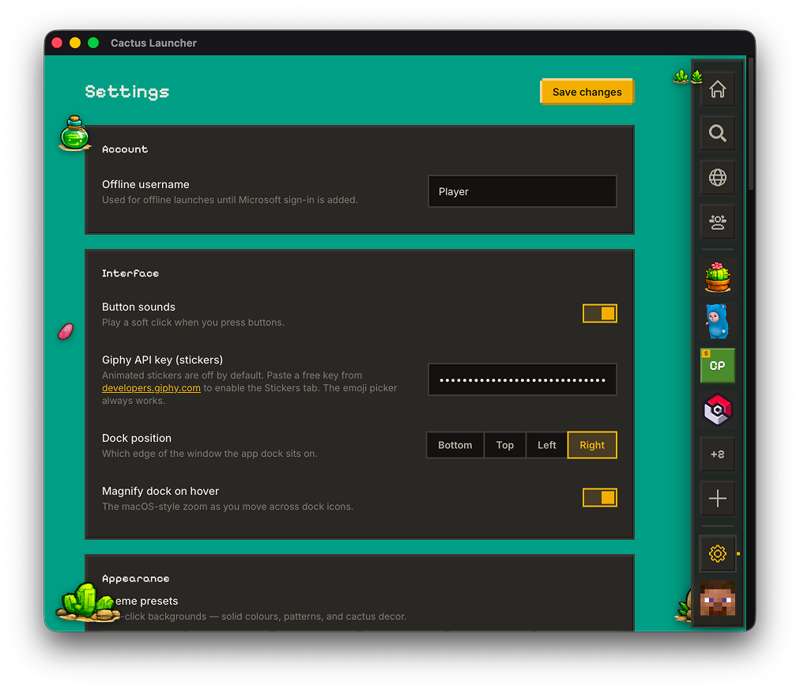

<div align="center">



# Cactus Launcher

**A cozy, fast, ad-free Minecraft launcher.**
Arrange your instances, install mods, run servers, and play together.

_Spiky, but not spooky._ 🌵

[](https://github.com/Ladvace/cactus-mc-launcher/actions/workflows/ci.yml)
[](LICENSE)

[](https://discord.gg/bfdUaMf7Mg)

Built with **Rust** · **[Rune](https://github.com/anomalyco/rune)** (native, GPU-rendered UI)

</div>

---

> [!WARNING]
> **Cactus is mainly an experiment.** It's a test of how far a fully native, GPU-rendered
> Rust UI ([Rune](https://github.com/anomalyco/rune)) can go for a real desktop app, ported
> from an earlier Tauri + Svelte version. So it's a work in progress and **it will have bugs**:
> expect rough edges, and things may change between versions. Please
> [report anything you hit](https://github.com/Ladvace/cactus-mc-launcher/issues).

## Screenshots

|  |  |
| --- | --- |
|  |  |
| **Home** — instances you arrange into folders, with custom icons & covers | **Themes** — backgrounds, gradients and cactus decor |
|  |  |
| **Servers** — a quick-connect list with live status | **Run a server** — console, worlds, sharing |
|  |  |
| **Community** — share & import setups, play together | **Accounts** — Microsoft sign-in, skins & capes |
|  |  |
| **Groups** — organize instances into folders | **Settings** — theming, dock, Java & more |

## Why Cactus

- 🚫 **No ads, ever.** Free and open-source — no tracking, no upsells, no premium tier.
- 🪶 **Native.** No browser engine and no WebView: the whole app, UI included, is one Rust binary (see [Lightweight](#lightweight)).
- 🎨 **Make it yours.** Themeable backgrounds, gradient/decor presets, a customizable dock, and drag-to-group instances with cover images.
- 🔒 **Your keys stay yours.** No secrets are baked into the client; online features are optional and off by default.

## Features

- **Instances** — create per-version, per-loader instances; drag to group; custom icons & covers; playtime tracking.
- **Mod loaders** — Vanilla, **Fabric**, **Quilt**, **Forge**, and **NeoForge** (Forge/NeoForge run the official installer headlessly on first launch).
- **Content** — browse and install mods, resource packs, shaders, and datapacks from **Modrinth** and **CurseForge**; per-instance enable/disable/remove; one-click `.mrpack` / `.cactuspack` install.
- **Adaptive Tune-up** — inspects your RAM/CPU and the instance's loader/version, then recommends a tailored performance mod set (Sodium, Lithium, …), heap size, and JVM flags. Transparent and editable — not a black box. Optional **Visuals** mode adds shaders.
- **Servers** — create dedicated-server instances, an interactive console, `server.properties` editor, worlds, ops/whitelist management, and one-command sharing.
- **Play together** — a presence panel showing who's online, filterable by version/loader.
- **Community boards** — shareable creator/server/streamer pages with published instance snapshots (opt-in, powered by the [backend](#backend)).
- **Accounts** — Microsoft sign-in (device code) with multi-account support, plus offline mode.
- **Managed Java** — the right Java runtime is downloaded automatically per version; Apple Silicon Rosetta handling for old LWJGL.

## Lightweight

Cactus is written entirely in **Rust**. Its interface is drawn by [Rune](https://github.com/anomalyco/rune), a GPU-rendered UI framework (Metal on macOS, through wgpu elsewhere), so there's no WebView or bundled browser engine: the launcher logic and the UI run in the same native process.

> We don't publish size or idle-RAM figures for this build yet; we'd rather measure them reproducibly before quoting numbers.

## Download

Grab the latest build from the [**website**](https://cactus.gianmarcocavallo.com) or the
[**releases page**](https://github.com/Ladvace/cactus-mc-launcher/releases) —
macOS, Windows, and Linux. See the [**changelog**](CHANGELOG.md) for what's new.

## Building from source

Requires the [Rust toolchain](https://rustup.rs) (stable).

```bash
cargo run                # launch the desktop app (debug)
cargo run --release      # optimised build
cargo test --bin cactus-launcher  # tests
```

`cargo run` uses the real data folder (`~/Library/Application Support/com.ladvace.cactuslauncher`
on macOS). Set `CACTUS_DATA_DIR=/some/folder` to run against a throwaway copy instead.

To build installers locally (`cargo install cargo-packager` once):

```bash
cargo build --release && cargo packager --release   # target/release: .app + .dmg on macOS
```

The UI can also run headless, which is how it's checked: `cargo run -- --list-scenes`, then
`cargo run -- --snap shot.png --scene home --size 1180x760` renders a screen to PNG, and
`--tree tree.json` dumps the element tree (see Rune's "Agent tooling" docs for `--script`).

### Releasing

Bump `version` in `Cargo.toml`, then push a matching tag (`git tag v1.12.0 && git push origin v1.12.0`).
The [release workflow](.github/workflows/release.yml) builds macOS (Apple Silicon and Intel: `.dmg`),
Windows (NSIS installer) and Linux (`.deb`, AppImage), signs and notarizes the Mac builds, signs
the update archives with the updater key, and puts them in a **draft** release with `latest.json`.
Publishing the draft ships it: installed copies, including ones still on the old Tauri build,
pick it up from `latest.json`.

### Online features (all optional)

| Feature | How to enable |
| --- | --- |
| Microsoft login | Set `AZURE_CLIENT_ID` in `.env` (copy `.env.example`) (a personal-accounts Azure app with public client flows; Mojang app approval required). Offline mode needs nothing. |
| Community / CurseForge / presence | Deploy the [backend](#backend) and set `CACTUS_API_BASE` in `.env`. |
| Stickers (Giphy) | Add a Giphy key in Settings. |

Until configured, these stay inert and the launcher runs fully local.

## Backend

The community boards, presence, snapshot sharing, and the CurseForge proxy are served by a small **Cloudflare Worker + Supabase + R2** backend that lives in its own repository. The desktop app only ever receives public URLs — no secret keys are shipped in the client.

## Project structure

```
src/
  main.rs                app entry: window, fonts, headless scenes
  app.rs                 the app state (instances, settings, accounts, launch/install progress)
  shell.rs               window layout: background, page, dock, toasts, splash
  screens/               Home, browse, servers, community, achievements, settings, instance
  overlays/              dock, modals and menus, accounts + skin viewer, palette, extras
  ui/ theme.rs           shared widgets and the pixel design tokens
  core/                  background tasks, i18n, images, prefs, toasts
  backend/               launcher core
    host.rs              shared stores, data dir, progress events
    commands.rs          the operations the UI calls
    instance/ settings.rs  models + persisted stores
    minecraft/ modrinth/   Mojang manifest + Modrinth client
    sources/             content-provider abstraction (Modrinth, CurseForge)
    content/             install content into instances
    loader/              Fabric/Quilt/Forge/NeoForge profile handling
    launch/              the launch pipeline (download, java, args, process)
    tuneup.rs            adaptive performance recommendations
    http.rs              shared HTTP client (identifying User-Agent)
assets/                  fonts, locales, images, loader icons, app icons
```

Shared downloads live under `meta/` (versions, libraries, assets, java); per-instance
game files live in `instances/<id>/minecraft/`. Launch progress and logs reach the UI as
`launch-status` / `launch-progress` / `launch-log` events from the backend.

## Testing

`cargo test --bin cactus-launcher` runs the backend and UI unit tests; CI runs it on every push.

## Community

Questions, ideas, or want to help test? **[Join the Discord](https://discord.gg/bfdUaMf7Mg).**

## Contributing

Issues and PRs welcome. Please run `cargo build` and `cargo test --bin cactus-launcher` before opening a PR.

## License

Licensed under the [GNU Affero General Public License v3.0](LICENSE) (AGPL-3.0-only).
